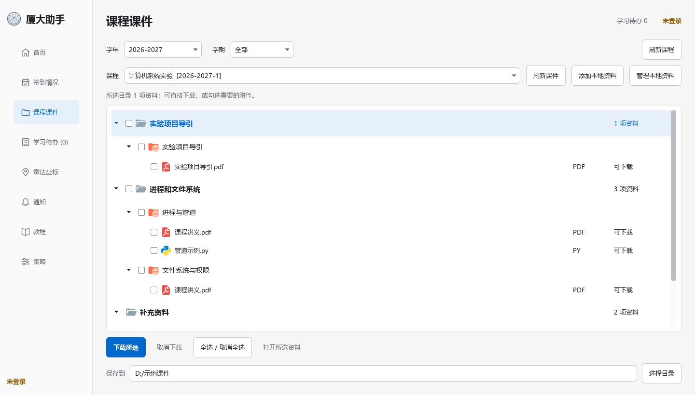
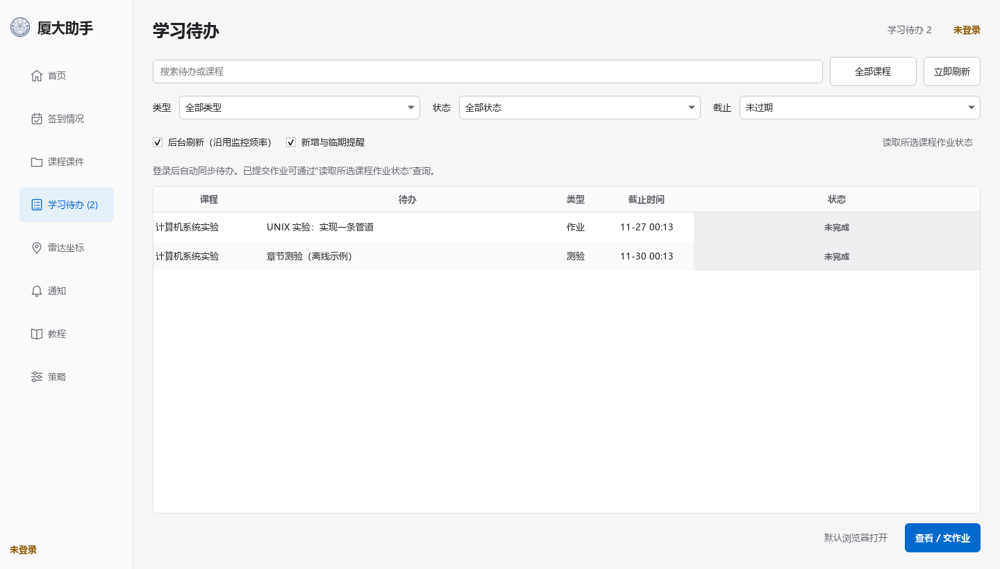
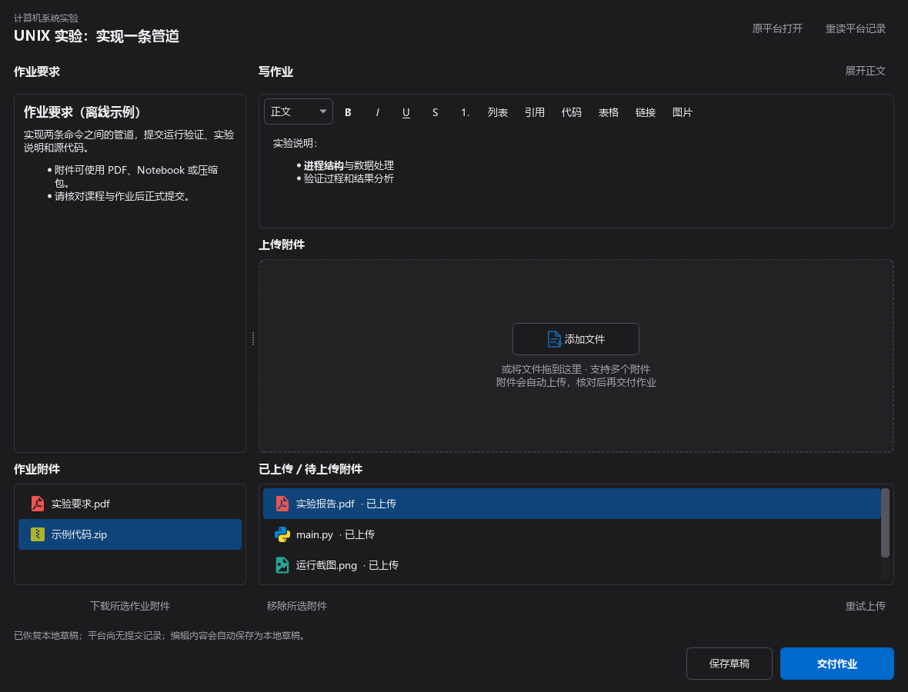
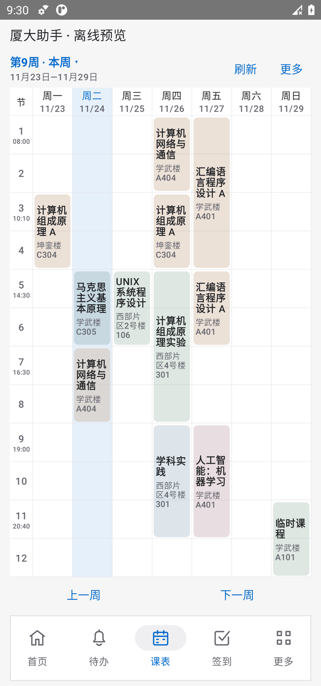
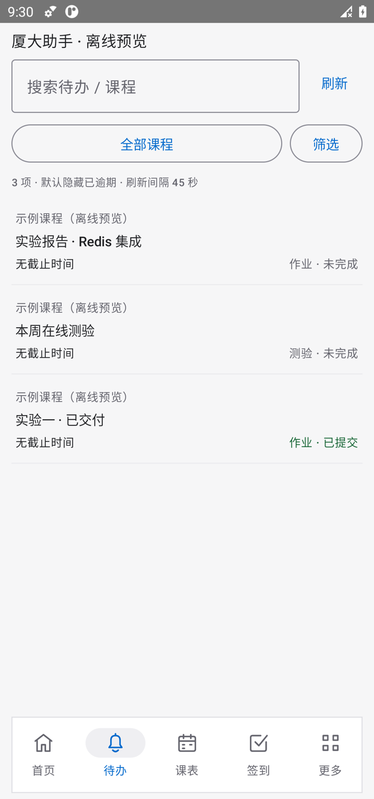
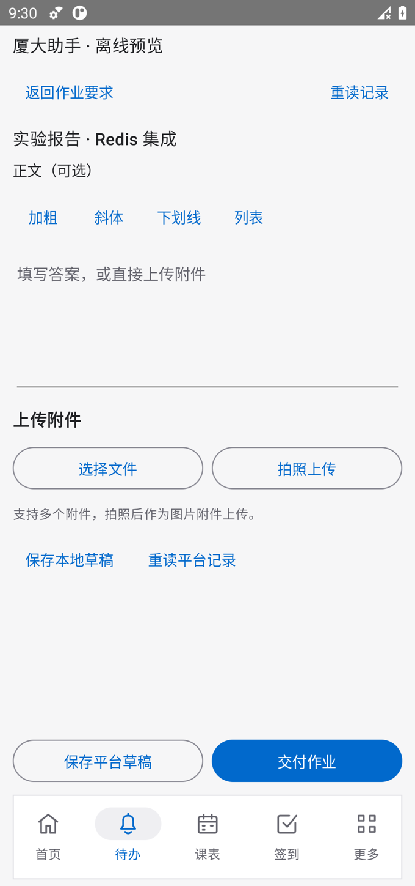
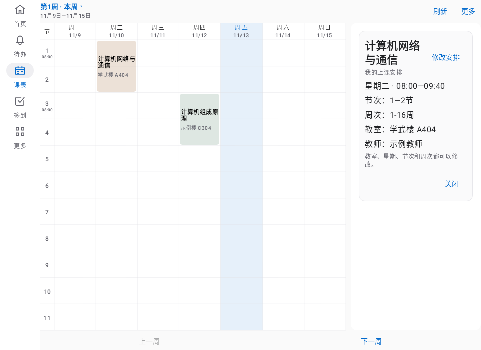
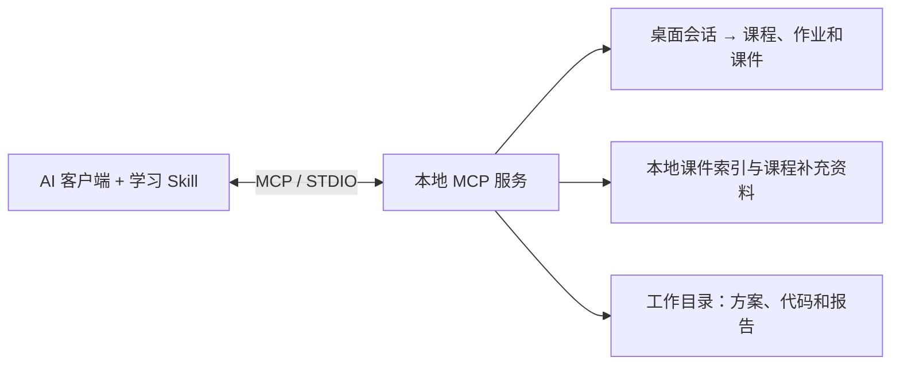

# 厦大助手 · XMU Assistant

**在手机上看课表和待办，在电脑上管理课件与作业，让 AI Agent 读懂具体的课程任务。**

[下载 Windows](https://github.com/banshiluoye/xmu-assistant/releases/download/v1.10.2/XMU-Assistant-1.10.2.exe) · [下载 Android](https://github.com/banshiluoye/xmu-assistant/releases/download/v1.10.1/XMU-Assistant-Android-1.10.1.apk) · [接入 AI 客户端](#安装-mcp-和-skill) · [观看实验演示](#一句话启动实验任务)

我以 [democard/xmu_assistant v1.8.4](https://github.com/democard/xmu_assistant/tree/v1.8.4) 为基础，围绕自己的课程学习流程做了大幅改造。原作者提供了 Windows 和 Android 客户端、后台监控、教务查询和课件下载的基础。这个版本在此基础上重做了课件和作业流程、Android 周课表与后台恢复，并新增了可接入其他 AI 客户端的 MCP 和学习 Skill。

## 一句话启动实验任务

视频用合成课程回放实际的本地 MCP 调用。客户端定位作业，读取教师附件和进程课件，在工作目录生成实验方案与示例代码，运行管道并检查输出及退出码。录制时用脚本编排调用，方案与代码为演示样例。

还可以把任务换成「读学科实践的 Redis 实验要求和工程附件，给出接入方案和验证清单」，或「根据课件讲解 IPv6，并标出资料页码」。MCP 提供查询、读取和保存工具，Skill 告诉 AI 如何定位课程、引用来源和组织成果。实际编写、运行或测试代码由 AI 客户端执行，需要相应的文件权限与运行环境。正式提交默认关闭，用户可先检查本地成果。

## 相比原版，升级在哪里

对比基线为本项目采用的上游 **v1.8.4**。[查看原版功能与说明](https://github.com/democard/xmu_assistant/blob/v1.8.4/README.md)

| 场景 | 上游 v1.8.4 | 厦大助手（Windows 1.10.2 / Android 1.10.1） |
| --- | --- | --- |
| **Android 锁屏监控** | 已有前台服务、会话恢复和电池设置提示，长期后台运行仍受厂商省电策略影响 | 新增分厂商的「锁屏监控设置」入口。监控期间可尝试续登，网络恢复后唤醒等待、失败时退避重试，并记录最近检查与异常 |
| **学习待办** | 可查学习记录和提醒 | Windows / Android 独立待办页，按课程、类型、截止时间和完成状态筛选。默认隐藏过期项，临期提醒可配置，测验可在浏览器打开 |
| **课件与自带资料** | 可按课程浏览和批量下载，Windows 列表已有平台章节目次 | Windows 下载目录细化到课程、章节和课件活动，目录分支按需展开。可添加外部教材或笔记，大文件保留原位置引用；已关联资料可供 MCP 读取 |
| **写作业与交附件** | 原版主要提供学习记录和课件下载 | 待办直达作业要求、教师附件及撰写界面，支持富文本和本地草稿。Windows 可拖入文件，Android 可拍照上传，也支持只交附件 |
| **Android 课表** | 已有七天周表、日程视图和桌面小组件 | 重做周课表，打开即看整周，课程卡展示教室。支持单次改期、临时加课、节假日调课，以及平板横屏的周表与详情并排 |
| **AI 工作流** | 学习信息主要通过应用界面查询 | Windows 提供独立 MCP 与学习 Skill，AI 可按课程读取要求、附件和课件，处理本地成果，或分析用户给出的成绩表 |
| **故障排查与界面** | 已有系统通知与状态查看 | 双端连点校徽五次可导出诊断日志，Windows MCP 可读监控摘要。双端有浅色和深色模式，Android 适配平板 |

**锁屏漏检是这次改造针对的实际问题。** 荣耀等系统可能在长时间锁屏后限制应用，监控中断就有可能错过签到。此版本把厂商设置入口、会话续登、网络重试和诊断记录做进了监控流程。使用时从 Android 首页进入「锁屏监控设置」，按设备提示允许后台活动，再观察通知里的「最近检查」是否持续更新。后台行为仍取决于设备设置、系统、校园网络和会话，签到结果以教学平台记录为准。[荣耀后台运行说明](https://www.honor.com/cn/support/content/zh-cn00406916/) · [Android 休眠与应用待机机制](https://developer.android.com/training/monitoring-device-state/doze-standby)

## 界面预览

以下是应用的离线截图，课程、附件和教师均为演示数据。

### Windows

**课程课件** · 按章节和活动查找文件，课程目录可收纳本地教材与笔记。

**学习待办与作业** · 在待办筛选课程任务，打开作业要求和附件，在编辑器里写正文或拖入文件。

| 学习待办 | 作业编辑 · 深色模式 |
| --- | --- |
|  |  |

### Android 手机与平板

**平板横屏** · 周课表保留整周总览，右侧查看教室、教师和节次。

## 安装

| 平台 | 发布文件 | 使用方式 |
| --- | --- | --- |
| Windows | [1.10.2 EXE](https://github.com/banshiluoye/xmu-assistant/releases/download/v1.10.2/XMU-Assistant-1.10.2.exe) | 从托盘退出旧版，再运行新文件 |
| Android | [1.10.1 APK](https://github.com/banshiluoye/xmu-assistant/releases/download/v1.10.1/XMU-Assistant-Android-1.10.1.apk) | Android 8.0 及以上，兼容同签名旧版覆盖安装 |
| AI 扩展（Windows） | [MCP 1.10.2](https://github.com/banshiluoye/xmu-assistant/releases/download/v1.10.2/XMU-Study-MCP-1.10.2-Windows.zip) | 解压后在 AI 客户端注册本地 STDIO 服务 |
| 学习 Skill | [Skill 1.10.2](https://github.com/banshiluoye/xmu-assistant/releases/download/v1.10.2/xmu-study-assistant-skill-1.10.2.zip) | 解压后把 `xmu-study-assistant` 放入支持 Agent Skills 的客户端技能目录 |

双端首次用自己的校园账号登录。发布文件的 SHA-256 见 Release 中的 `SHA256SUMS.txt`，可用 PowerShell 的 `Get-FileHash` 核对。安卓沿用历史版本的调试签名用于覆盖更新，请以本仓库的发布文件与校验值核实来源。macOS 和 iOS 暂缓。

### 安装 MCP 和 Skill

1. 在 Windows 助手登录。MCP 复用当前桌面会话，读取本机监控诊断无需校园登录。
2. 在 Codex 中使用时，解压 AI 扩展 ZIP，运行 `安装到Codex.ps1`，然后重载 MCP 或重启客户端。也可把本仓库链接交给具备本地工具和下载权限的 AI 客户端，请它按本节指导安装。
3. 其他支持本地 STDIO 的客户端可把 `xmu-study-mcp-1.10.2.exe` 的绝对路径设为命令，参数留空。支持 Agent Skills 的客户端可以额外安装 Skill。
4. 用「列出我未过期的学习待办」验证。云端 AI 客户端会把选定的课程内容交给所用模型服务，按需指定课程和文件。

[详细配置与权限说明](ai-integration/README.md) · [查看学习 Skill](ai-integration/skills/xmu-study-assistant/SKILL.md)

## 技术栈与源码

| 模块 | 技术栈 | 代码 |
| --- | --- | --- |
| Windows 桌面 | Python、PySide6 / Qt Widgets、Requests、Windows DPAPI、PyInstaller | [桌面界面](xmu-rollcall-cli/xmu_rollcall/desktop_qt) |
| Android | Kotlin、Jetpack Compose / Material 3、协程、OkHttp、Foreground Service、WorkManager、Gradle | [Android 源码](android/app) |
| AI 与文档 | MCP Python SDK（STDIO）、Agent Skills、pypdf、本地资料索引与按账号隔离的工作目录 | [MCP 服务](xmu-rollcall-cli/xmu_rollcall/mcp_bridge) · [AI 扩展](ai-integration) |
| 回归验证 | pytest、Compose UI 测试、Robolectric、Android Lint | [Python 测试](tests) · [Android 测试](android/app/src/test) |

MCP 按需启动，桌面应用无需为 AI 接入增加常驻轮询。大课件目录按需更新，本地大文件可只关联路径。

### 从源码构建

- **Windows** · 建立 Python 虚拟环境，安装 `requirements-ci.txt` 和 PyInstaller，执行 `python -m PyInstaller --noconfirm xmu-assistant.spec`。
- **Android** · 使用 JDK 17 与 Android SDK 35，在 `android` 目录执行 `gradlew.bat :app:testDebugUnitTest :app:lintDebug :app:assembleDebug`，或用 `bash gradlew` 执行相同任务。自行签名的 APK 只能覆盖同签名应用。
- **MCP** · 安装 `ai-integration/requirements.txt`，把 `xmu-rollcall-cli` 加入 Python 搜索路径后运行 `python -m xmu_rollcall.mcp_bridge`。独立运行包可用 `python -m PyInstaller --noconfirm scripts/xmu-mcp.spec` 构建。

## 隐私与来源

账号、会话、课程数据、个人资料、运行日志及签名密钥保存在使用者或构建者本机。仓库截图和视频使用合成资料。MCP 可读选定的教学资料，符合权限条件时才写入草稿或提交。反馈监控问题时，可连点应用校徽五次导出日志，分享前请遮盖个人信息。

代码沿用 [Apache-2.0 许可](LICENSE)。感谢 [democard/xmu_assistant](https://github.com/democard/xmu_assistant) 与项目所用开源依赖的作者。校徽与素材来源见 [校徽说明](assets/XMU-EMBLEM-SOURCE.md) 及各素材目录的署名文件。本项目由个人独立维护。
